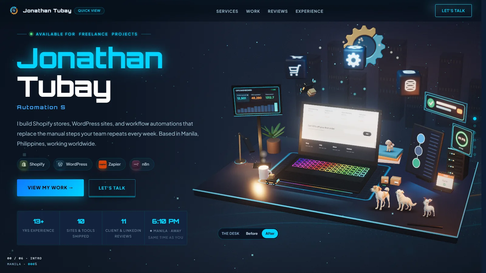
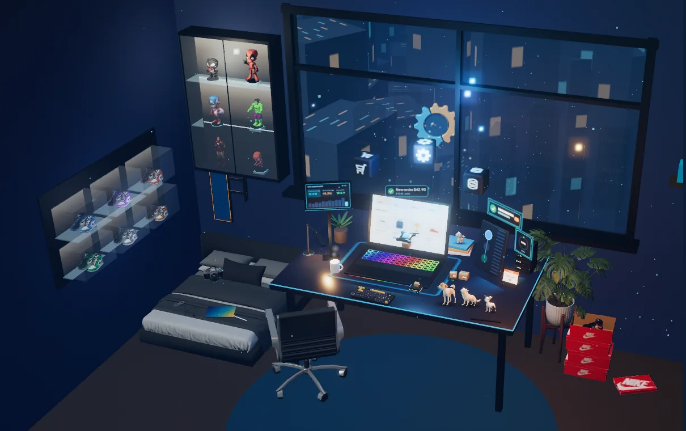

# jonathantubay.com

**Live: [jonathantubay.com](https://jonathantubay.com)**

Static portfolio. No framework and no npm install. The only runtime
library is three.js 0.170 (WebGL) for the 3D hero desk, loaded from
jsDelivr; the bedroom world around it is desktop only. Without WebGL (or
in Quick View) the page falls back to a still poster.

## Tech stack

| Area | Used |
|---|---|
| Markup and styles | Hand-written HTML sections and CSS partials, no framework |
| Scripts | Vanilla JavaScript (IIFE partials, no bundler) |
| 3D | three.js 0.170: GLTFLoader, meshopt decoder, EffectComposer with bloom |
| 3D assets | Blender + Python (`3d/build_scene.py`) for the desk scene; Sketchfab CC BY models for the room, optimized with glTF-Transform (meshopt, WebP textures) |
| Build | Node `build.js` + `minify.js`: concatenates, minifies, content-hashes, writes the sitemap |
| Images | WebP renders with responsive `srcset` variants (Pillow) |
| Fonts | Orbitron and Plus Jakarta Sans, self-hosted variable woff2 |
| Hosting | Netlify (publishes `dist/`, skips builds for docs-only pushes), Netlify Forms with honeypot and reCAPTCHA (Special Thanks note) |
## Structure

    src/
      _head.html            <head> + opening <body>, plus the critical
                            inline CSS and the @font-face declarations
      _order.txt            section order for index.html
      manifest.json         concatenation order for css/js
      sections/             24 page sections and chapter tunnels, one file each
      styles/               36 css partials, grouped by area
      scripts/main/         26 partials -> main.js
      scripts/effects/      34 partials -> effects.js
    fonts/                  self-hosted variable woff2 (latin) + OFL texts
    img/                    source renders and their responsive variants
                            (img/hero3d/: WebGL desk scene, room models)
    3d/                     Blender scripts for the hero desk scene
    docs/                   guides and audits (not deployed)
    history/                daily work log (not deployed)
    build.js                assembles src/ into dist/
    minify.js               the whitespace/comment minifiers build.js uses
    dist/                   build output (gitignored, published by Netlify)

Everything in `dist/` is **generated**. Edit `src/` instead.

## Build

    node build.js

Order matters. The CSS cascade and the IIFE execution order in the JS both
depend on `src/manifest.json` and `src/_order.txt`, so the build never
sorts or dedupes. Adding a section means adding the file AND its name to
`_order.txt`; adding a stylesheet or script partial means adding it to
`manifest.json`.

The build also:

- **minifies** the HTML, CSS and JS (`minify.js`). Comments and
  indentation only — nothing is renamed, reordered or removed, and
  newlines survive in the JS so ASI behaves as in the source.
- **content-hashes** the CSS and JS filenames (`style.<hash>.css`) and
  rewrites every reference, in `index.html` and in `case-studies/*.html`.
  This is what allows the `immutable` cache headers in `netlify.toml`: a
  changed file always arrives under a new URL, so there is nothing to
  invalidate. The build throws rather than shipping a page whose
  stylesheet reference it could not rewrite.
- **generates `sitemap.xml`** from each page's canonical URL and the date
  of the last commit that touched its sources.

## Desktop 3D world

Desktops (min-width 1024 and a fine pointer) get the 3D world: the hero
desk, then a gamer bedroom around it, chapter tunnels between sections, a
HUD, Manila day/night and the dogs. `html.dk` is set before first paint in
`src/_head.html`; desktop-only markup is `.d-only`, phone-only `.m-only`.
Phones and tablets keep the flat layout and never load the room.

Main files: `scripts/effects/36-hero-3d.js` (scene, room, props),
`scripts/main/25-chapter-tunnels.js` (scroll progress, hero hand-over),
`scripts/main/27-world-hud.js`, `scripts/effects/41-world-extras.js`.
The room's models, credits and how to add one are in
[docs/3d-room.md](docs/3d-room.md). Every CC BY model is credited in the
footer's `d-only` line.

## Images

`img/preview-*.webp` are the full-size renders. Each has `-360w`, `-720w`
and `-1080w` variants used by the card `srcset`; the modals use `-1080w`
plus the original. The hero's still is `img/hero3d/hero-poster-*.webp`, a
frame of the live WebGL desk (desktop: `-1000w`/`-1600w`, framed like the
canvas so the 3D fade-in swaps nothing; phones/tablets: `-m480w`/`-m720w`/
`-m930w`, cropped to the scene box). Re-capture it whenever the scene
changes (steps in 3d/build_scene.py, "hero poster").

Regenerating variants after replacing a render is a Pillow resize at
quality 82 (`method=6`); the widths above are the only ones referenced.

## Fonts

Orbitron and Plus Jakarta Sans are self-hosted as single variable woff2
files, latin subset, preloaded, with `font-display: optional`.

They used to come from fonts.googleapis.com loaded asynchronously, which
meant the page always painted in the fallbacks and then re-laid-out every
line of text when the real faces arrived — measured as CLS 0.372 on mobile
and 0.103 on desktop. `optional` is the guarantee that a slow network can
cost the webfont but never the layout.

Both families are SIL OFL 1.1; the licence texts ship in `fonts/`.

## Local preview

    node build.js && python -m http.server 5500 --directory dist

Then http://localhost:5500. Hashed filenames mean a rebuild changes the
URLs, so a plain refresh is enough — no hard-refresh needed.

## Deploy

Netlify runs `node build.js` and publishes `dist/`. Only files listed in
`build.js`'s STATIC array reach production, so internal working folders
cannot leak.
